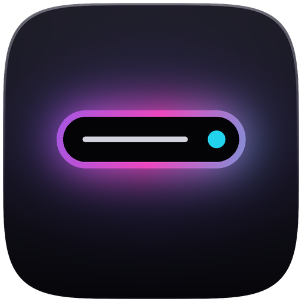
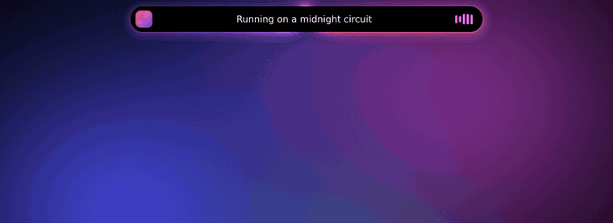
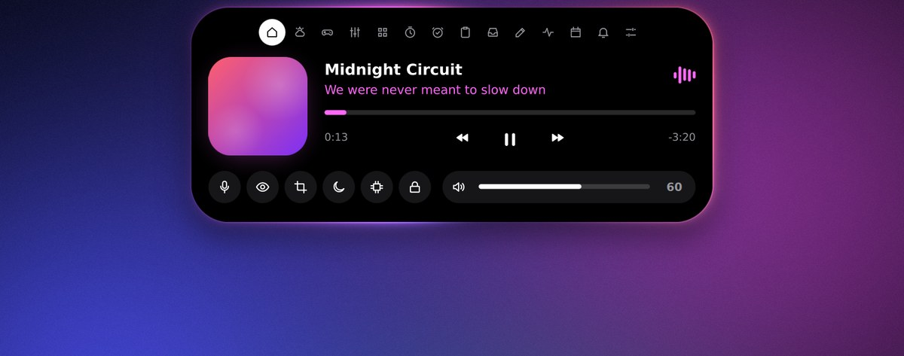
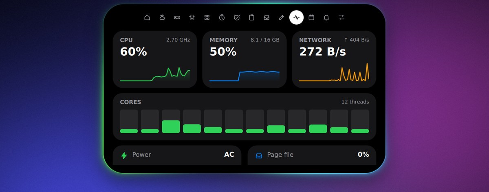
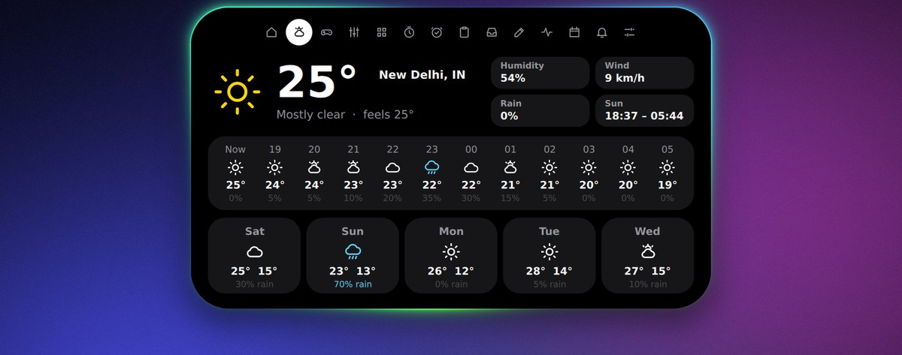
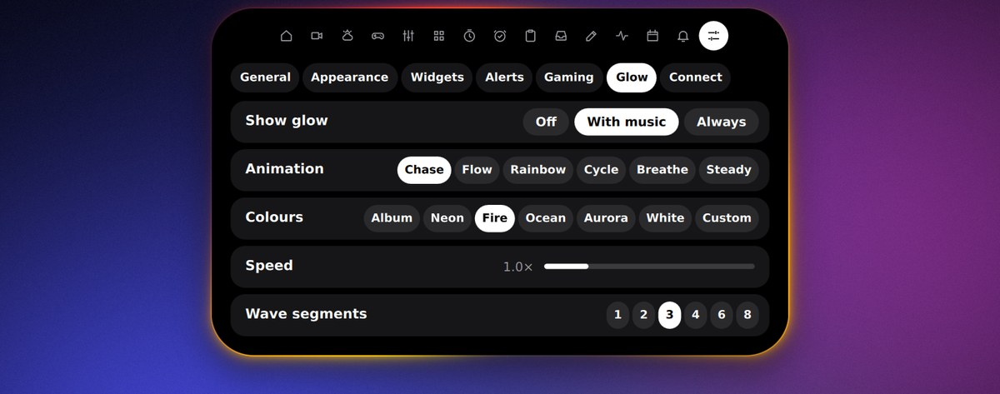
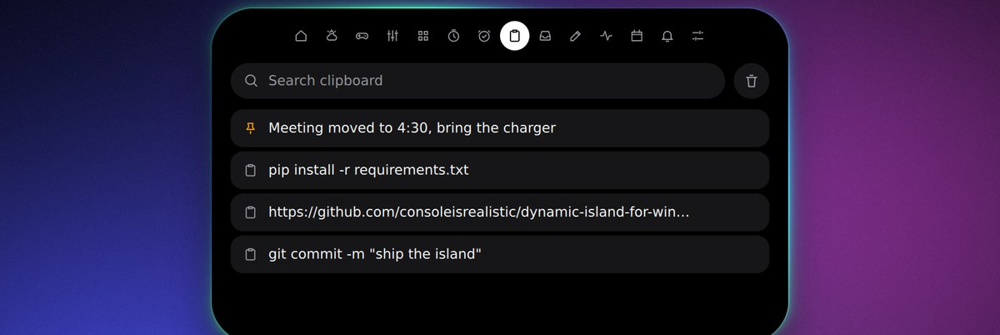
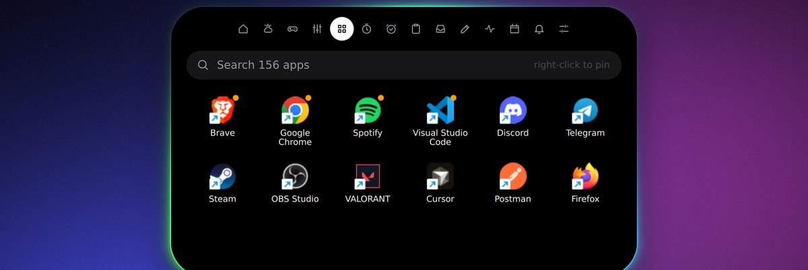
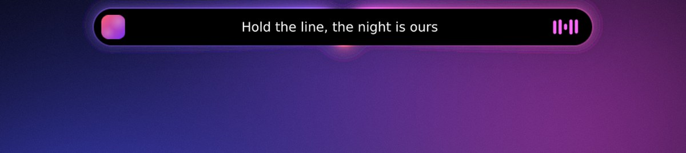

<div align="center">



# Island

**A Dynamic Island for Windows.**
Music, AI answers, notifications, timers, clipboard and live stats, right at the top of your screen.

[](https://github.com/consoleisrealistic/dynamic-island-for-windows/releases/latest)
[](#system-requirements)
[](LICENSE)

[**Download**](https://github.com/consoleisrealistic/dynamic-island-for-windows/releases/latest/download/IslandSetup.exe) &nbsp;·&nbsp; [**Watch the demo**](https://github.com/consoleisrealistic/dynamic-island-for-windows/releases/latest/download/Island-demo.mp4) &nbsp;·&nbsp; [**Website**](https://consoleisrealistic.github.io/dynamic-island-for-windows/) &nbsp;·&nbsp; [**Release notes**](https://github.com/consoleisrealistic/dynamic-island-for-windows/releases)

<a href="https://github.com/consoleisrealistic/dynamic-island-for-windows/releases/latest/download/Island-demo.mp4"></a>

<sub>Click the preview to watch the full two-minute demo.</sub>

</div>

---

## Contents

- [Features](#features)
- [Screenshots](#screenshots)
- [System requirements](#system-requirements)
- [Install](#install)
- [Update](#update)
- [Uninstall](#uninstall)
- [Troubleshooting](#troubleshooting)
- [Privacy](#privacy)
- [License](#license)
- [Credits](#credits)

## Features

| | |
| --- | --- |
| **Now playing** | Album art, a live visualiser, playback controls and time-synced lyrics for Spotify and any app that uses Windows media controls. Optional Hinglish lyrics for Punjabi, Hindi and Haryanvi songs. |
| **Ask** | Ask Gemini anything from the island, with optional web results. Bring your own free key from Google AI Studio; Island picks a working model and falls back to another one when a limit is reached. |
| **Translate** | Translate between 160 languages, with auto-detect. |
| **Copy text from the screen** | Press **Ctrl + Alt + T**, drag over anything and the text is copied. Uses offline Windows OCR, or Gemini if you turn on smart OCR. |
| **Quick maths and currency** | Type sums, percentages or "500 usd to inr" and get the answer instantly. Understands k, lakh and crore. |
| **AI Agents** | Watch Claude Code, Codex, Cursor, Gemini CLI and other coding agents work, see what they change and approve their permission requests right from the island. |
| **To-do, water and speed test** | A to-do list, a water reminder, an internet speed test and screenshots with a built-in editor. |
| **Ambient mode** | **Ctrl + Alt + F** turns the screen into full-screen lyrics in four styles. |
| **Stays off your tabs** | Choose what happens when the island covers browser tabs: shrink to a slim line, move to a corner, keep a strip free at the top, or turn see-through when you reach for a tab. |
| **Hover to open** | The pill expands into a control centre when you glide over it and tucks away when you leave. |
| **Smart pop-ups** | Volume, brightness, track changes, USB devices, battery and network events slide in and out. |
| **Notifications** | Messages from your apps are mirrored into the island, with a feed of recent ones. |
| **Clipboard history** | Every copy is confirmed and kept. Pin what matters, search the rest. |
| **Focus timers** | Pomodoro-style focus and break timers that stay visible in the pill, with a chime when time is up. |
| **Quick notes and reminders** | Jot things down, set one-off or repeating reminders. |
| **Performance** | CPU, memory, GPU, network, drives, battery and top processes at a glance. |
| **Sound and brightness** | Switch output and input devices, set volume and screen brightness. |
| **App launcher** | Search and launch every installed app. |
| **Weather and calendar** | Current conditions, hourly and five-day forecast, and your month. |
| **Meeting Quick Join** | Upcoming Google Calendar meetings with one-click join for Meet, Zoom and Teams. |
| **Gaming mode** | Shrinks into a tiny HUD with FPS, CPU, GPU, temperature, RAM and ping. FPS is counted with Windows' own event tracing; nothing is injected into games. |
| **Glow** | An animated edge light that reacts to music. Wave, breathe, steady or colour cycle, in your colours. |
| **Lightweight** | About 0.2% CPU and 80 MB of RAM while idle on a typical laptop. |
| **Built-in updates** | Checks for new versions and installs them safely, or leaves it to the Store or WinGet when that is how you installed. |

## Screenshots

<table>
<tr>
<td><br><sub>Now playing</sub></td>
<td><br><sub>Performance</sub></td>
</tr>
<tr>
<td><br><sub>Weather</sub></td>
<td><br><sub>Glow settings</sub></td>
</tr>
<tr>
<td><br><sub>Clipboard history</sub></td>
<td><br><sub>App launcher</sub></td>
</tr>
<tr>
<td><br><sub>Synced lyrics in the pill</sub></td>
<td><br><sub>Gaming HUD</sub></td>
</tr>
</table>

## System requirements

| | |
| --- | --- |
| **Windows** | Windows 10 version 1809 or later, or Windows 11 |
| **Architecture** | 64-bit (x64) |
| **Disk** | About 200 MB |
| **Other** | Nothing else. Python, Git and developer tools are **not** needed. |

## Install

### Option 1: one command (recommended)

Open **PowerShell** and run:

```powershell
irm https://raw.githubusercontent.com/consoleisrealistic/dynamic-island-for-windows/main/install.ps1 | iex
```

The script checks your Windows version, downloads the latest official installer from this repository's releases, verifies its SHA-256 checksum (and its signature, once releases are signed), then runs it. It never runs a file that fails a check. [Read the script](install.ps1) before running it if you like.

### Option 2: download the installer

1. Download **[IslandSetup.exe](https://github.com/consoleisrealistic/dynamic-island-for-windows/releases/latest/download/IslandSetup.exe)** from the [latest release](https://github.com/consoleisrealistic/dynamic-island-for-windows/releases/latest).
2. Optional: compare its SHA-256 with `SHA256SUMS.txt` in the same release:
   ```powershell
   Get-FileHash .\IslandSetup.exe -Algorithm SHA256
   ```
3. Run it. Island installs for your user account (no admin rights needed) and can start with Windows.

> [!NOTE]
> Island releases are not code-signed yet, so Windows SmartScreen may show **"Windows protected your PC"**. Choose **More info**, then **Run anyway**. The checksum is how you confirm the file is genuine.

### Option 3: portable

Download **Island-portable.zip** from the [latest release](https://github.com/consoleisrealistic/dynamic-island-for-windows/releases/latest), extract it anywhere and run `Island.exe`. The portable copy tells you about new versions but does not install them.

### Microsoft Store and WinGet

Island is not on the Microsoft Store or in WinGet yet. This section will list the Store link and the `winget install` command once they are published.

## Update

Island checks for updates at start-up and every 8 hours (you can turn this off). To check by hand, open the island, go to **Settings › Updates** and press **Check for updates**.

| Installed with | How updates arrive |
| --- | --- |
| Island installer or the PowerShell command | **Download and install** in Settings › Updates. Island downloads the official installer, verifies it, updates itself and restarts. Your settings are kept. |
| Portable zip | Settings › Updates opens the new release; download and replace the folder. |
| WinGet (when available) | `winget upgrade --id consoleisrealistic.Island -e` |
| Microsoft Store (when available) | The Store updates Island automatically. |

## Uninstall

Open **Settings › Apps › Installed apps**, find **Island**, choose **Uninstall**.

The uninstaller removes the program, its shortcuts and its start-up entry. It then asks whether to delete your settings and data as well (notes, clipboard history, reminders). Choose **No** to keep them for a future install. Your data lives in `%APPDATA%\island`.

## Troubleshooting

<details>
<summary><b>The island doesn't appear</b></summary>

- Look for the Island icon next to the clock. Right-click it and choose **Hide or show**.
- Press **Ctrl + Alt + H** (or **Ctrl + Shift + H** if another app owns the first shortcut) to show or hide it.
- If another "dynamic island" app is running, quit it. Two islands fight over the same spot.
- Settings › General › **Hide in fullscreen** hides it while a full-screen app is focused.
</details>

<details>
<summary><b>Music or lyrics don't show</b></summary>

- Island reads Windows media controls. The player must show up in the Windows volume flyout's media panel.
- Lyrics come from the free lrclib.net database. Songs without time-synced lyrics there show none.
</details>

<details>
<summary><b>FPS shows as "--" in gaming mode</b></summary>

- Windows only lets administrators or members of **Performance Log Users** read frame events. Open Settings › Gaming and press **Allow** next to *FPS counter*, approve the prompt, then sign out and back in once.
- DirectX 9 to 12 games are supported. Vulkan and OpenGL games are not counted.
</details>

<details>
<summary><b>SmartScreen or antivirus warns about the installer</b></summary>

New, unsigned apps are flagged until they build a reputation. Verify the file's SHA-256 against `SHA256SUMS.txt` in the release. If it matches, it is the official build.
</details>

<details>
<summary><b>Something else</b></summary>

Logs are in `%APPDATA%\island\island.log` and `crash.log`. Please [open an issue](https://github.com/consoleisrealistic/dynamic-island-for-windows/issues) and attach them.
</details>

## Privacy

Island runs on your PC and sends **no analytics or telemetry**. It only goes online for features you use:

| Feature | Service | What is sent |
| --- | --- | --- |
| Lyrics | lrclib.net | Song title, artist and length |
| Weather | open-meteo.com | The city you choose, or coordinates from IP-based location (ipapi.co or ipwho.is) when you pick *Detect automatically* |
| Meeting Quick Join (optional) | Google Calendar | Read-only access you grant; tokens are encrypted with Windows DPAPI on your PC |
| Ask, Translate, OCR fallback (optional) | Google Gemini API, with your own key | The text, question or screenshot area you send; the key is encrypted with Windows DPAPI |
| Currency conversion | open.er-api.com | A request for exchange rates |
| Speed test | Cloudflare, Hetzner, OVH or Linode test servers | Test data only, when you start a test |
| Agent icons | Google or DuckDuckGo favicon services | The website of each coding agent you connect |
| Update checks | github.com | A request for `version.json` |

Full details: [PRIVACY.md](PRIVACY.md).

## License

Island is **freeware**: free to use on any number of your own PCs, for personal or commercial work. It is closed source; redistribution and reverse engineering are not permitted. See [LICENSE](LICENSE).

This repository holds the public website, documentation, installer script and release downloads. The application's source code is private.

## Credits

Made by **[@consoleisrealistic](https://github.com/consoleisrealistic)**.

Built with [Qt for Python (PySide6)](https://doc.qt.io/qtforpython/), [psutil](https://github.com/giampaolo/psutil), [pycaw](https://github.com/AndreMiras/pycaw), [PyWinRT](https://github.com/pywinrt/pywinrt), lyrics from [LRCLIB](https://lrclib.net) and weather from [Open-Meteo](https://open-meteo.com). Packaged with [PyInstaller](https://pyinstaller.org) and [Inno Setup](https://jrsoftware.org/isinfo.php).
